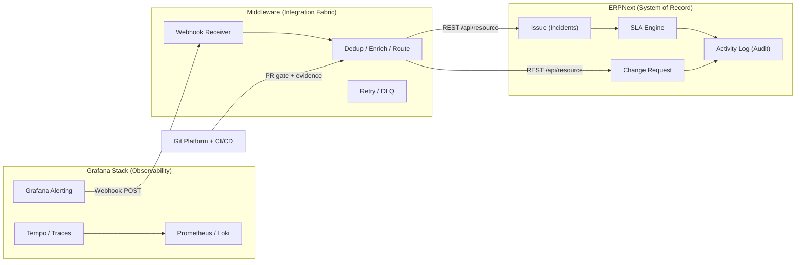

# ITSM Implementation Guide

**Document ID:** ITSM-IMPL-001
**Version:** 1.0
**Status:** For Implementation
**Alignment:** ITSM-SRS-001 v1.0 (enterprise requirements) · ITSM-ARCH-001 v1.0 (agreed architecture)
**Audience:** Infrastructure/platform engineers — competent developers, new to this integration pattern

---

## 1. Executive Summary & Tech Stack

This guide operationalizes the approved ITSM & Operations Architecture (ITSM-ARCH-001) against the enterprise requirements of ITSM-SRS-001. It is a copy-paste-ready build book: every section maps a configuration artifact (DocType, Workflow, contact point, webhook, CI job) to the SRS requirement IDs and acceptance criteria (AC-001–AC-012) it satisfies.

### 1.1 The Stack

| Component | Role | Version Baseline |
|-----------|------|------------------|
| **ERPNext** (Frappe Framework) | **System of Record** — incidents, change requests, SLAs, approvals, immutable audit trail (Activity Log + Version log) | v15+ / v16 |
| **Grafana** | **Observability & Topology** — metrics, logs, traces (OpenTelemetry), alerting engine, Service Graphs | v11+ (Alerting GA) |
| **Middleware** (n8n *or* Python FastAPI) | **Integration Fabric** — event ingestion, fingerprint deduplication, severity→priority enrichment, ERPNext REST orchestration, auto-close, retry/DLQ | n8n 1.x / Python 3.11 |
| **Git** (GitHub/GitLab) | **Change Vehicle & Evidence** — PRs as implementation mechanism, branch protection as enforcement, CI as evidence collector | — |

### 1.2 Core Principle

> **ERPNext is the System of Record. Grafana is Observability. The Middleware is the Integration Fabric.**

Consequences of this principle (from ITSM-ARCH-001 §2):

- All cross-system communication flows **through the middleware** — no point-to-point integrations.
- ERPNext and Grafana remain authoritative for their own data; the middleware translates, enriches, and routes — it **never becomes a second system of record** (state that must survive restarts is written to ERPNext custom fields, not only middleware memory).
- The Git Pull Request is the *implementation vehicle* for code changes — the ERPNext `Change Request` is always the authoritative record.
- One process for all change types: code, infrastructure, hardware, vendor, and configuration changes follow the identical ERPNext workflow.

### 1.3 Requirement Coverage Map

| SRS Requirement Group | Delivered In |
|-----------------------|--------------|
| Incident creation from monitoring (INC-002, INT-002, INT-003) | Phase 2 — Monitoring Pipeline |
| Change types, risk, approvals, evidence (CHG-001–CHG-017) | Phase 1 — Custom DocType & Workflow |
| Git traceability & approval gates (CHG-003, CHG-009, CHG-013, CHG-016) | Phase 3 — Git Integration |
| Service/CI linkage & topology (INT-004, INT-005) | Phase 2 + Phase 4 — Service Topology |
| Integration failure handling (INT-009, INT-010) | Phase 2 — Retry/DLQ + secrets handling |
| Audit & acceptance (NFR-006, NFR-012, AC-001–AC-012) | Phase 1–4 + §6 Acceptance Checklist |



---

## 2. Phase 1: The ERPNext Foundation (Custom DocType & Workflow)

**Goal:** A single `Change Request` DocType that is the authoritative record for every change type (SRS §5.3, CHG-001–CHG-017), with an approval workflow that blocks implementation until authorized (AC-004, AC-005).

**ERPNext phases 1–2 of ITSM-ARCH-001 §6 (Weeks 3–4).**

### 2.1 Prerequisites

- Administrator (or System Manager) access to the ERPNext instance.
- Roles planned (create in **User List → Roles** or `Setup → Roles`): `Change Requester`, `Change Approver`, `Change Implementer`, `Change Manager`. Assign `Change Approver` **only** to the CTO and Infra Lead. (Role-based access control satisfies NFR-002; approval separation satisfies CHG-009 / SRS §5.4.)
- A dedicated **integration user** `itsm-middleware@yourdomain` for all API calls (see §3.8) — never use Administrator for machine traffic (INT-010).

### 2.1.1 Step-by-Step Role Creation in ERPNext

1. Create Roles:
   - Navigate to: **Setup → Roles** (or search "Role List" in Awesomebar).
   - Click "New" for each role: Change Requester, Change Approver, Change Implementer, Change Manager.
   - Save each role.

2. Assign Roles to Users:
   - Navigate to: **User List** → open a user (e.g., CTO).
   - In the "Roles" table, add the appropriate roles:
     - CTO: Change Approver, Change Manager
     - Infra Lead: Change Approver
     - Engineers: Change Requester, Change Implementer
   - Save the user.

3. Verify Workflow Button Visibility:
   - Log in as a non-approver (e.g., an engineer).
   - Open a Change Request in "Pending Approval" state.
   - Confirm that "Approve" and "Reject" buttons are NOT visible.
   - Log in as the CTO, open the same Change Request, and confirm the buttons ARE visible.
   - This validates that the workflow's Allowed role restriction is working correctly.

4. Test API User:
   - Create the integration user: itsm-middleware@yourdomain.
   - Assign minimal roles: Helpdesk User (or a custom role with only Read/Create on Issue and Change Request).
   - Generate API keys: Go to the user's settings → "API Access" → "Generate Keys".
   - Copy the API Key and API Secret immediately (the secret is shown only once).
   - Store them securely (environment variables or a secrets manager).

### 2.2 Create the DocType

1. Open the Awesomebar (`Ctrl+K`) → search **DocType List** → **New DocType** (or `Settings → DocType → New`).
2. Set **Module**: e.g. `ITSM` (create a custom module first via **Module Def** if you want a clean namespace).
3. Configure the header options:

| Option | Value | Why |
|--------|-------|-----|
| Name (DocType name) | `Change Request` | Referenced everywhere: API paths, workflow, PR checks |
| Is Submittable | ✅ Checked | `docstatus` 0/1/2 gives immutable submitted records + cancellation semantics — required for audit integrity (NFR-006, CHG-016) |
| Track Changes | ✅ Checked | Version log records every field edit (audit trail) |
| Naming (Autoname) | **Expression**: `format:CRQ-{YYYY}-{#####}` | Auto-generates unique Change IDs like `CRQ-2026-00001` (CHG-005). Set it in the DocType's *Naming* section. Alternative: `By "Naming Series" field` with series `CRQ-.YYYY.-` |

4. Add the fields below (§2.3), **Save**.
5. After saving, run **Role Permission Manager** for `Change Request`:
   - `Change Requester`: Read, Write, Create, Submit (own documents).
   - `Change Approver`: Read, Write, Submit, Cancel, Amend.
   - `Change Implementer`: Read, Write (to record evidence), Submit.
   - `Change Manager`: Read, Write, Submit, Cancel, Amend + Report view.
   - Keep **User Permissions** off initially; state-level edit locking is handled by the workflow (§2.6).

### 2.3 Field Definitions — Core Table

| # | Field Name (fieldname) | Label | Field Type | Mandatory | Options / Notes |
|---|------------------------|-------|-----------|-----------|-----------------|
| 1 | `title` | Change Title | **Data** | ✅ Yes | Max 140 chars; human-readable summary |
| 2 | `change_type` | Change Type | **Select** | ✅ Yes | Options (newline-separated): `Standard\nNormal\nEmergency` — SRS CHG-001 |
| 3 | `risk_level` | Risk Level | **Select** | ✅ Yes | Options: `Low\nMedium\nHigh\nCritical` — drives approval chain (CHG-008/CHG-009) |
| 4 | `justification` | Justification | **Text Editor** | ✅ Yes | Business impact + why the change is needed (CHG-006) |
| 5 | `affected_services` | Affected Services | **Small Text** | ✅ Yes | Comma-separated service labels — **must match Grafana `service` label** exactly (INT-004). Tip: later replace with a Link/child table to a Service master once one exists |
| 6 | `implementation_steps` | Implementation Steps | **Text Editor** | ✅ Yes | Numbered plan (CHG-007) |
| 7 | `rollback_plan` | Rollback Plan | **Text Editor** | ✅ Yes | CHG-007 / AC-006 |
| 8 | `approval_status` | Approval Status | **Select** | Auto (read-only) | Options: `Pending\nApproved\nRejected\nImplemented\nClosed` — **updated automatically by a server script that syncs from workflow_state on every transition** (§2.6). Do not let users edit; keep it visible for list views |
| 9 | `approved_by` | Approved By | **Link** → `User` | Auto (set on approval) | Redundant with the Workflow Action log (which records approver identity + timestamp, CHG-016) but kept as a reporting convenience field |
| 10 | `linked_pr_url` | Linked PR URL | **Data** (set *Options* = `URL` for clickable link) | Optional | GitHub/GitLab PR link — enforced via PR template + CI (§4) |
| 11 | — | *Change ID* | *(Naming — not a field)* | — | `CRQ-{YYYY}-{#####}` autoname set in §2.2 |

### 2.4 Field Definitions — Supplementary (recommended)

| # | Field Name | Label | Field Type | Mandatory | Notes |
|---|-----------|-------|-----------|-----------|-------|
| 12 | `testing_procedure` | Testing Procedure | Text Editor | For Normal/Emergency | CHG-007 |
| 13 | `emergency_reason` | Emergency Reason | Text Editor | **Mandatory Depends On**: `eval:doc.change_type=="Emergency"` | CHG-004 / AC-005 — Frappe's *Mandatory Depends On* property makes this conditional |
| 14 | `risk_score` | Risk Score | Int | No | Optional automated impact×likelihood scoring (CHG-008) |
| 15 | `planned_start` / `planned_end` | Planned Start / End | **Datetime** | For Normal | Change calendar basics (CHG-011) |
| 16 | `actual_start` / `actual_end` | Actual Start / End | Datetime | No | Recorded by implementer / CI (CHG-013) |
| 17 | `deployment_evidence` | Deployment Evidence | **Code** (or Small Text) | No | Commit SHA, pipeline URL, artifacts — written by CI (§4.4) |
| 18 | `needs_pir` | Requires Post-Implementation Review | Check | No | Auto-checked for Emergency/failed changes (CHG-015) |
| 19 | `linked_incident` | Linked Incident | **Link** → `Issue` | No | CHG-014: failed change → incident linkage |
| 20 | `service_label` | Source Service (Monitoring) | Data | No | Populated when a change is auto-created from an alert (optional flow) |

**Naming note:** to stay consistent with the architecture doc's rich lifecycle, you can add optional states/fields later (Risk Assessment, PIR) — the 6-state core below is the minimum that passes AC-004/AC-005.

### 2.5 Section Layout (optional polish)

Group fields into Section Breaks: *Overview* (title, type, risk, services) → *Justification* → *Plan* (implementation, testing, rollback) → *Schedule* (datetimes) → *Approval* (approval_status, approved_by, linked_pr_url) → *Evidence* (deployment_evidence, linked_incident, needs_pir).
### 2.6 Configure the Workflow (Workflow Builder)

Open the Awesomebar (`Ctrl+K`) → **Workflow List** → **New** (or `Settings → Workflow`). Fill the header:

| Field | Value |
|-------|-------|
| **Workflow Name** | `Change Request Approval` |
| **Document Type** | `Change Request` |
| **Is Active** | ✅ Checked |
| **Workflow State Field** | `workflow_state` (auto-added to the DocType by ERPNext; do **not** create it manually) |
| **Don't Override Status** | Leave unchecked |

Then add **Document States** (table `states`) — one row per state:

| # | State | Icon | Style | Description |
|---|-------|------|-------|-------------|
| 1 | Draft | — | — | Change Request created |
| 2 | Pending Approval | — | — | Awaiting CAB/approver review |
| 3 | Approved | — | Green | Authorized for implementation |
| 4 | Rejected | — | Red | Approval denied |
| 5 | Implemented | — | Blue | Deployment evidence recorded |
| 6 | Closed | — | Grey | Post-implementation verified |

Then add **Transitions** (table `transitions`). Each row connects `state` → `next_state` via an `action` button shown on the document form:

| # | State | Action | Next State | Allowed (roles) | Conditions |
|---|-------|--------|------------|-----------------|------------|
| 1 | Draft | Submit for Approval | Pending Approval | `Change Requester` | — |
| 2 | Pending Approval | Approve | Approved | `Change Approver` (CTO, Infra Lead) | `doc.risk_level in ["Low","Medium"]` for single approval; high/critical needs CHG-009 extra approvals |
| 3 | Pending Approval | Reject | Rejected | `Change Approver` | — |
| 4 | Approved | Mark Implemented | Implemented | `Change Implementer` | Requires `linked_pr_url` or deployment evidence (`deployment_evidence` non-empty) |
| 5 | Implemented | Close | Closed | `Change Requester` / `Change Manager` | After post-implementation review if `needs_pir` checked |
| 6 | Rejected | Resubmit | Draft | `Change Requester` | — |

**Role restriction — how it works:** In each transition row, the **Allowed** field is a `Link → Role`. Only users with that role see the action button on the form. ERPNext's workflow controller (frappe/workflow.py) enforces:
- `transition.state == current_state` and `transition.allowed` is in the user's roles — else "Workflow State transition not allowed".
- Self-approval is blocked by default (`Allow Self Approval` checkbox; leave **unchecked** for Approve).
- `doc_status` is set per target state: Approved=1, Implemented=1, Rejected=1, Closed=2.

**Enforce the gate (AC-004):** Because the DocType is **Submittable**, users can only reach `Approved`/`Implemented` via workflow transitions, never by direct edits. To make the approval gate airtight for emergency changes (AC-005), add a transition condition on the Approve row:

```
doc.change_type != "Emergency" or (doc.emergency_reason and doc.approved_by)
```

> **Note:** `Allowed` expects role *names* exactly as in the Role master (e.g. `Change Approver`, not `CTO`). Create roles first, then assign them to users (`User → User Roles` table).

### 2.6.1 Server Script: Sync approval_status from workflow_state

# File: apps/your_custom_app/your_custom_app/doctype/change_request/change_request.py
import frappe
from frappe.model.document import Document

class ChangeRequest(Document):
    def on_update(self):
        # Sync workflow_state to approval_status for reporting convenience
        if self.workflow_state and self.workflow_state != self.approval_status:
            self.db_set("approval_status", self.workflow_state, update_modified=False)

This server script ensures the `approval_status` field (used in list views and reports) stays in sync with the workflow engine's `workflow_state` field. Without this, `approval_status` would remain stale.

### 2.7 Approval Mapping Matrix

| Change Type | Risk | Required Approver Role | CAB required? | SRS ref |
|-------------|------|------------------------|---------------|---------|
| Standard | Low | Change Requester (self-authorized per pre-authorized model) | No | CHG-002 |
| Normal | Low/Medium | Change Approver (CTO or Infra Lead) | Yes if multi-service | CHG-003 |
| Normal | High/Critical | Change Approver + CAB (Change Manager validates) | Yes | CHG-009 |
| Emergency | Any | Change Approver (expedited), retrospective review required | No initially | CHG-004 / AC-005 |

### 2.8 Go Live

1. Click **Save** → **Enable** (Is Active).
2. Open a test Change Request, verify:
   - New docs start at `Draft`.
   - "Submit for Approval" moves to `Pending Approval`.
   - A non-approver cannot see "Approve"/"Reject".
   - `Change Approver` moves it to `Approved`.
   - `approval_status` select updates to match `workflow_state` (keep them in sync — optional server script on `workflow_state` change).

**Acceptance tied here:** AC-004 (normal change cannot proceed before approvals), AC-005 (emergency records authorization + retrospective review), NFR-002 / NFR-006 (role separation + audit records).

### 2.9 ERPNext SLA Configuration

ERPNext's native SLA engine calculates response and resolution deadlines, issues breach warnings, and drives escalation. Configure it per SRS §5.8 (SLA Management) and INC-008.

**Step 1 — Create Issue Priority Masters**
Navigate to **Setup → Support → Issue Priority** (or search "Issue Priority" in Awesomebar). Create one master per level:

| Priority | Description | Use Case |
|----------|-------------|----------|
| Critical | System down / major business impact | P1 outages, security incidents |
| High | Degraded service, workaround unavailable | P2 incidents affecting multiple users |
| Medium | Partial degradation, workaround available | P3 incidents |
| Low | Cosmetic issue, no business impact | P4 service requests |

**Step 2 — Configure SLA Rules**
Navigate to **Setup → Support → Service Level Agreement** → **New**. Create one SLA rule per priority:

| SLA Name | Applies To | Response Target | Resolution Target | Support Hours | SLA Pause |
|----------|------------|-----------------|-------------------|---------------|-----------|
| SLA-Critical | Priority = Critical | 15 minutes | 4 hours | 24×7 | Only on authorized hold |
| SLA-High | Priority = High | 30 minutes | 8 hours | Business hours | Only on authorized hold |
| SLA-Medium | Priority = Medium | 2 hours | 2 business days | Business hours | Only on authorized hold |
| SLA-Low | Priority = Low | 1 business day | 5 business days | Business hours | Only on authorized hold |

**Step 3 — Configure Escalation Rules**
On each SLA rule, add an escalation:

| SLA Rule | Escalate After | Notify | Action |
|----------|---------------|--------|--------|
| SLA-Critical | Response breach (15 min) | Change Manager + Infra Lead | Email + Slack notification |
| SLA-Critical | Resolution breach (4 h) | CTO | Page on-call backup |
| SLA-High | Response breach (30 min) | Change Manager | Email notification |

**Step 4 — Link SLA to Issue Creation**
The middleware sets `priority` on Issue creation (§3.3). ERPNext automatically:
1. Evaluates matching SLA rules based on the Issue's `priority` field.
2. Starts the response and resolution timers at `opening_date`.
3. Sets `response_by` and `sla_resolution_by` datetime fields.
4. Increments breach counters as deadlines approach/pass.

**Step 5 — Testing Step (SLA Enforcement)**
1. In ERPNext, create a test Issue with `priority = Critical`.
2. Confirm `response_by` is set to `opening_date + 15 minutes`.
3. Do not assign or touch the Issue for 15+ minutes.
4. Verify an escalation notification is sent to the Change Manager / Infra Lead per the escalation rule.
5. Assign the Issue and confirm the SLA timer stops counting toward response (per your pause policy).

## 3. Phase 2: The Monitoring Pipeline (Grafana → Middleware → ERPNext)

**Goal:** Any Grafana alert that fires creates exactly one correctly-prioritized ERPNext ticket; recovery webhooks auto-close it. No duplicates. (SRS AC-002, INT-002–INT-005, INC-002–INC-008)

**Architecture phase 1 of ITSM-ARCH-001 §6 (Weeks 1–2).**

### 3.1 Integrate: ERPNext credentials first

The middleware authenticates to ERPNext with a **token pair per integration user** (Frappe REST API docs):

1. In ERPNext, create user `itsm-middleware@yourdomain`; give it roles that can create/read `Issue`: e.g. `Helpdesk User` + `Support Team`, or a custom role with only Read/Create on Issue.
2. Open that User → **Settings** tab → **API Access** → **Generate Keys**. Copy **API Key** and **API Secret** immediately (the secret is shown once).
3. Store them as secrets — never in repo, never in logs:
   - n8n: Credentials → n8n's built-in credential store (encrypted at rest).
   - Python: environment variables `ERPNEXT_API_KEY`, `ERPNEXT_API_SECRET`, `ERPNEXT_BASE_URL`.

**Every request header:**

```
Authorization: token <api_key>:<api_secret>
Accept: application/json
Content-Type: application/json
```

### 3.2 Grafana Setup — Webhook Contact Point

1. In Grafana: **Alerts & IRM → Alerting → Notification configuration → Contact points**.
2. **Add contact point** → name it `itsm-webhook` → Integration: **Webhook** → URL: your middleware webhook endpoint (e.g. `https://middleware.example.com/webhook/grafana`).
3. **Optional settings** (recommended):
   - **Authentication Header Scheme:** `Bearer` (or custom) with **Authentication Header Credentials:** a shared secret token you validate in middleware (defense in depth, in addition to TLS).
   - **Max Alerts:** `50` — cap notification size; middleware should still iterate the `alerts` array.
   - **HMAC Signature:** enable with a shared secret; signature is sent in header `X-Grafana-Alerting-Signature` (default) — validate it on receipt to prevent spoofed alerts.
   - Leave **Disable resolved message** unchecked — you need `resolved` webhooks for auto-close (§3.6).
4. Save, then **Test** — verify your middleware receives a `200` test payload.
5. Route alert rules to this contact point (Notification Policy or the contact point on each alert rule).

#### Sample payload Grafana POSTs (default JSON)

Grafana sends one object with `status` = `firing` or `resolved`. The middleware normally handles `alerts[0]` (single alert per webhook) but should iterate all entries:

```json
{
  "receiver": "itsm-webhook",
  "status": "firing",
  "orgId": 1,
  "alerts": [
    {
      "status": "firing",
      "labels": {
        "alertname": "HighMemoryUsage",
        "service": "payments-api",
        "severity": "critical",
        "team": "platform",
        "instance": "10.0.4.12:9100"
      },
      "annotations": {
        "description": "Memory usage above 90% for 5 minutes on payments-api",
        "runbook_url": "https://runbooks.example.com/payments-high-memory",
        "summary": "High memory usage on payments-api (prod)",
        "dashboard_url": "https://grafana.example.com/d/payments",
        "ticket_owner": "@oncall-platform"
      },
      "startsAt": "2026-02-10T09:51:03.157076Z",
      "endsAt": "0001-01-01T00:00:00Z",
      "generatorURL": "https://grafana.example.com/alerting/1afz29v7z/edit",
      "fingerprint": "c6eadffa33fcdf37",
      "silenceURL": "https://grafana.example.com/alerting/silence/new?...",
      "dashboardURL": "",
      "panelURL": "",
      "values": {"B": 94.2, "C": 1}
    }
  ],
  "groupLabels": {},
  "commonLabels": {"team": "platform"},
  "commonAnnotations": {},
  "externalURL": "https://grafana.example.com/",
  "version": "1",
  "groupKey": "{}:{...}",
  "truncatedAlerts": 0,
  "state": "alerting",
  "title": "[FIRING:1] HighMemoryUsage",
  "message": "..."
}
```

Key fields the middleware consumes:

| Field | Source | Middleware use |
|-------|--------|----------------|
| `status` | top-level + each alert | `firing` → create/update ticket; `resolved` → auto-close |
| `alerts[].labels.alertname` | labels | Part of the fingerprint; ticket subject |
| `alerts[].labels.service` | labels | Linked to `Change Request.affected_services` / Issue service field (INT-004) |
| `alerts[].labels.severity` | labels | Mapped → ERPNext priority (severity→priority lookup table) |
| `alerts[].annotations.runbook_url` | annotations | Copied into ticket description (enrichment) |
| `alerts[].annotations.summary` | annotations | Ticket subject prefix |
| `alerts[].fingerprint` | alert object | **Primary dedup key** — Grafana-unique per alert rule+label set |
| `alerts[].startsAt` / `endsAt` | alert | Ticket timestamps |
| `externalURL` | top-level | Link back to Grafana in ticket |

### 3.3 Middleware Logic — Python FastAPI (reference implementation)

```python
# middleware/main.py  — copy-paste skeleton; install: fastapi, uvicorn, httpx, redis
import os, hashlib, json, hmac
from fastapi import FastAPI, Request, Header, HTTPException
from fastapi.responses import JSONResponse
import httpx

app = FastAPI()

BASE_URL   = os.getenv("ERPNEXT_BASE_URL", "").rstrip("/")   # e.g. https://erp.yourdomain
API_KEY    = os.getenv("ERPNEXT_API_KEY")
API_SECRET = os.getenv("ERPNEXT_API_SECRET")
WEBHOOK_SECRET = os.getenv("GRAFANA_WEBHOOK_SECRET", "")     # HMAC/shared-secret validation
DEDUP_TTL_SECONDS = int(os.getenv("DEDUP_TTL_SECONDS", "86400"))  # 24h dedup window

# Severity (Grafana) -> ERPNext Issue Priority (Link to Issue Priority master)
SEVERITY_TO_PRIORITY = {
    "critical": "Critical",   # create these Issue Priority masters in ERPNext first
    "high":     "High",
    "warning":  "Medium",
    "info":     "Low",
}

HEADERS = {
    "Authorization": f"token {API_KEY}:{API_SECRET}",
    "Accept": "application/json",
    "Content-Type": "application/json",
}

def erp(path, method="GET", payload=None, params=None):
    url = f"{BASE_URL}/api/resource/{path}"
    with httpx.Client(timeout=15) as c:
        r = c.request(method, url, headers=HEADERS, json=payload, params=params)
    r.raise_for_status()
    return r.json().get("data")

def find_ticket_by_fingerprint(fingerprint: str):
    """INT-003: dedupe — check whether an Issue already carries this fingerprint."""
    filters = [[["fingerprint", "=", fingerprint]]]
    tickets = erp("Issue", params={"filters": json.dumps(filters),
                                  "fields": '["name","status","priority","subject"]'})
    return tickets[0] if tickets else None

def compute_fingerprint(alert: dict) -> str:
    """Fallback fingerprint = SHA256(alertname + sorted labels), stable across restarts."""
    labels = alert.get("labels", {})
    key = f'{alert.get("labels",{}).get("alertname","")}:{json.dumps(labels, sort_keys=True)}'
    return hashlib.sha256(key.encode()).hexdigest()[:16]

@app.post("/webhook/grafana")
async def grafana_webhook(request: Request,
                          x_grafana_signature: str | None = Header(None)):
    body = await request.body()

    # ---- 0. Authenticate the webhook source ----
    if WEBHOOK_SECRET and x_grafana_signature:
        expected = hmac.new(WEBHOOK_SECRET.encode(), body, hashlib.sha256).hexdigest()
        if not hmac.compare_digest(expected, x_grafana_signature or ""):
            raise HTTPException(status_code=401, detail="invalid signature")

    payload = json.loads(body)
    status  = payload.get("status")          # "firing" | "resolved"
    results = []

    for alert in payload.get("alerts", []):
        fingerprint = alert.get("fingerprint") or compute_fingerprint(alert)
        labels      = alert.get("labels", {})
        annotations = alert.get("annotations", {})
        service     = labels.get("service", "unknown")
        severity    = labels.get("severity", "info")
        priority    = SEVERITY_TO_PRIORITY.get(severity, "Low")
        subject     = f"[{severity.upper()}] {labels.get('alertname','')} — {service}"
        description = (
            f"Source: Grafana Alerting ({payload.get('externalURL')})\n"
            f"Alert: {labels.get('alertname')}\n"
            f"Service: {service}\n"
            f"Severity: {severity}\n"
            f"Instance: {labels.get('instance','')}\n"
            f"Fingerprint: {fingerprint}\n\n"
            f"{annotations.get('description','')}\n\n"
            f"Runbook: {annotations.get('runbook_url','')}\n"
            f"Dashboard: {annotations.get('dashboard_url','')}\n"
        )

        # ---- 1. Deduplication ----
        existing = find_ticket_by_fingerprint(fingerprint)
        if existing and status == "firing":
            # Duplicate within dedup window: update existing ticket only
            ticket_name = existing["name"]
            erp(f"Issue/{ticket_name}", method="PUT",
                payload={"description": existing.get("description","") + "\n---\n" + description,
                         "_comments": f"Duplicate alert received at {alert.get('startsAt')}"})
            results.append({"fingerprint": fingerprint, "action": "updated_existing",
                            "ticket": ticket_name})
            continue

        # ---- 2. Enrichment + API call ----
        if status == "firing":
            doc = {
                "subject": subject,
                "description": description,
                "priority": priority,
                "fingerprint": fingerprint,          # custom field — add to Issue DocType
                # map service label into an Issue custom field if you add one:
                # "custom_service": service,
                # "raised_by": "grafana-webhook@yourdomain",
            }
            name = erp("Issue", method="POST", payload=doc)["name"]
            results.append({"fingerprint": fingerprint, "action": "created",
                            "ticket": name, "priority": priority})

        # ---- 3. Auto-close on recovery ----
        elif status == "resolved":
            existing = find_ticket_by_fingerprint(fingerprint)
            if existing:
                ticket_name = existing["name"]
                # Only auto-close tickets that workflow rules allow; keep human-investigation tickets open
                if existing.get("status") not in ("Resolved", "Closed"):
                    erp(f"Issue/{ticket_name}", method="PUT",
                        payload={"status": "Resolved",
                                 "resolution_details": f"Auto-resolved: Grafana alert cleared at {alert.get('endsAt')}"})
                results.append({"fingerprint": fingerprint, "action": "auto_closed", "ticket": ticket_name})
            else:
                results.append({"fingerprint": fingerprint, "action": "resolved_no_ticket"})

    return JSONResponse({"processed": len(results), "results": results})
```

### 3.3.1 Tuning DEDUP_TTL_SECONDS

The default `DEDUP_TTL_SECONDS = 86400` (24 hours) is a reasonable starting point, but should be tuned based on alert behavior:

- **Flapping alerts** (e.g., CPU spikes that recover quickly): Consider reducing to 1–4 hours to avoid suppressing legitimate re-fires.
- **Persistent issues** (e.g., disk full, service down): 24h is appropriate; the alert will auto-close when resolved.
- **Maintenance windows:** If you need to suppress alerts during planned maintenance, implement a separate maintenance-window suppression layer rather than extending the dedup TTL.

Monitor duplicate ticket creation rates after go-live and adjust the TTL accordingly.

**Deploy:** `uvicorn middleware.main:app --host 0.0.0.0 --port 8000` behind TLS. Grafana contacts `https://middleware.example.com/webhook/grafana`.

**Acceptance tied here:** AC-002 (trigger Grafana alert → single prioritized Issue without duplicates), INT-003 (dedup), INT-004 (service linkage), INT-002 (event rules create/update incidents).

#### Issue DocType custom fields to add first

In ERPNext DocType `Issue` (standard Helpdesk DocType), add these custom fields so the middleware can write them:

| Field Name | Label | Field Type | Mandatory | Notes |
|------------|-------|-----------|-----------|-------|
| `fingerprint` | Grafana Fingerprint | Data | No | Unique index recommended; dedup key |
| `grafana_status` | Grafana Status | Select | No | Options: `firing\nresolved` |
| `source_system` | Source System | Select | No | Options: `Grafana` |
| `custom_service` | Service | Link → (your Service master) or Data | No | From `labels.service` |
| `grafana_url` | Grafana URL | Data (Options = URL) | No | From `externalURL` + generatorURL |

### 3.4 Middleware Logic — n8n (visual alternative)

If you prefer n8n over Python, build this workflow:

1. **Webhook node** (`POST /webhook/grafana`) → receives Grafana payload.
2. **IF node**: `status == "resolved"` → branch to Auto-close path; else Create/Update path.
3. **Set node**: compute fingerprint = `{{ $json["alerts"][0]["fingerprint"] }}` (or crypto hash of alertname+labels).
4. **HTTP Request node** (ERPNext search): `GET {{ $json.erpBaseUrl }}/api/resource/Issue?filters=[["fingerprint","=","{{ $json.fingerprint }}"]]` with Header `Authorization: token {{ $credentials.apiKey }}:{{ $credentials.apiSecret }}`.
5. **IF node**: ticket exists?
   - **No** → HTTP Request `POST .../api/resource/Issue` with body `{subject, description, priority, fingerprint, ...}`; priority from a **No-Op/Code** severity→priority mapping object.
   - **Yes** → HTTP Request `PUT .../api/resource/Issue/{{ ticket.name }}` appending occurrence note.
6. **Resolved branch:** HTTP Request `PUT .../api/resource/Issue/{{ ticket.name }}` body `{status: "Resolved", resolution_details: "..."}`.

**n8n credentials:** create one "Header Auth" credential with `Authorization: token <api_key>:<api_secret>`. Store Grafana HMAC secret as a n8n credential too. Use n8n's built-in retry (Workflow Settings → Failure → Retry) for transient ERPNext failures; dead-letter via an error workflow writing to a `Webhook Error Log` DocType or a DLQ table (INT-009).

### 3.5 Error Handling & Resilience (INT-009)

| Failure | Behavior |
|---------|----------|
| ERPNext 5xx / timeout | Retry with exponential backoff (max 3 attempts), then dead-letter to a DLQ table/email alert |
| ERPNext 4xx (auth/validation) | Do **not** retry; alert the platform team; inspect API key/secret and field names |
| Middleware restart mid-flight | Idempotent by fingerprint — re-processing the same alert is safe because lookup+create is keyed on fingerprint |
| Secret rotation | Rotate API key/secret pair together; update middleware secret without downtime by loading from env/secret manager at request time |

### 3.6 Middleware Self-Monitoring (INT-008)

The middleware must monitor its own availability and integration health per SRS INT-008. Implement the following:

**Health Endpoint:**

```python
@app.get("/health")
async def health_check():
    # Check ERPNext connectivity
    try:
        erp("User", method="GET", params={"filters": '[["name","=","Administrator"]]'})
        erp_status = "healthy"
    except Exception as e:
        erp_status = f"unhealthy: {str(e)}"

    return {
        "status": "ok" if erp_status == "healthy" else "degraded",
        "erpnext": erp_status,
        "timestamp": datetime.utcnow().isoformat()
    }
```

**Metrics to Track:**

- Webhook receive count (success/failure)
- ERPNext API call success/failure rate
- Average processing time per alert
- Dead-letter queue depth
- Middleware uptime

**Implementation Options:**

- **Simple:** Log metrics to stdout and aggregate via Grafana Loki or a log-based dashboard.
- **Advanced:** Expose Prometheus metrics at `/metrics` endpoint and scrape with Prometheus.

**Alerting:**

- Alert if middleware health endpoint returns non-200 for > 2 minutes.
- Alert if dead-letter queue depth > 10 items.
- Alert if ERPNext API failure rate > 5% over 5 minutes.

### 3.7 Auto-Close Rules (SRS §5.7)

- On `resolved`: match fingerprint → if ticket exists and is open, set `status = Resolved` + `resolution_details` with recovery timestamp.
- **Do not auto-close** tickets that require human investigation/verification — keep a middleware config `AUTO_CLOSE_SEVERITIES = ["info", "warning"]` and leave `critical`/`high` open for the on-call engineer to close after verification.
- Record who/what closed it: `resolved_by = grafana-webhook` (or the integration user).

### 3.8 On-Call Rotation Implementation

The middleware escalates alerts to the right engineer based on the on-call schedule. Three options are provided; **Option B (YAML/JSON schedule in Git)** is recommended for teams starting out, as it keeps the schedule version-controlled and reviewable without depending on a third-party calendar service.

**Option A — Shared Google Calendar API**
Publish the on-call roster to a shared Google Calendar. The middleware polls the Calendar API (or receives push notifications) to determine who is on call at alert time. Pros: familiar to non-technical staff; cons: API rate limits, OAuth complexity, single point of failure if calendar access breaks.

**Option B — YAML/JSON Schedule in Git [Recommended for Start]**
Commit a rotation schedule file to the repository (e.g. `config/oncall.yml`). The middleware reads it at startup and reloads on change (or via webhook on merge). This is auditable, reviewable via PR, and requires no external calendar API.

```yaml
# config/oncall.yml
timezone: UTC
rotations:
  - name: primary
    schedule:
      - start: "2026-02-09T00:00:00Z"
        end:   "2026-02-16T00:00:00Z"
        user:  "alice@example.com"
      - start: "2026-02-16T00:00:00Z"
        end:   "2026-02-23T00:00:00Z"
        user:  "bob@example.com"
  - name: backup
    schedule:
      - start: "2026-02-09T00:00:00Z"
        end:   "2026-02-16T00:00:00Z"
        user:  "bob@example.com"
      - start: "2026-02-16T00:00:00Z"
        end:   "2026-02-23T00:00:00Z"
        user:  "carol@example.com"
```

**Option C — ERPNext Custom DocType**
Create a custom `On-Call Rotation` DocType in ERPNext with fields for rotation name, start/end datetimes, and assignee (Link → User). The middleware queries ERPNext to resolve the current on-call engineer. Pros: single system of record; cons: adds load to ERPNext for every alert.

**Middleware Escalation Logic (pseudo-code)**

```python
# Middleware escalation loop — runs per incoming alert
def escalate_alert(alert, ticket):
    priority   = ticket.priority          # from severity→priority mapping
    fingerprint = ticket.fingerprint
    now        = utcnow()

    # 1. Resolve current on-call engineer from schedule
    primary   = oncall_schedule.now("primary", now)
    backup    = oncall_schedule.now("backup", now)

    # 2. Set the on-call engineer on the ticket
    ticket.oncall_engineer = primary.user
    ticket.save()

    # 3. Notify primary immediately
    notify(primary.user, channel="slack", message=f"P1 Incident {ticket.name}: {ticket.subject}")
    notify(primary.user, channel="email",  message=f"P1 Incident {ticket.name} created")

    # 4. If P1 and unacknowledged after 15 minutes, page backup
    if priority == "Critical" and ticket.status == "Open":
        schedule_in(minutes=15, callback=check_and_escalate, args=[ticket, backup])

def check_and_escalate(ticket, backup):
    ticket.reload()
    if ticket.status == "Open" and ticket.escalation_count < 3:
        ticket.escalation_count += 1
        ticket.save()
        notify(backup.user, channel="slack", message=f"ESCALATION: P1 Incident {ticket.name} unacknowledged for 15 min")
        notify(backup.user, channel="sms",   message=f"ESCALATION: P1 Incident {ticket.name} — call now")
        # Optional: PagerDuty/Twilio voice call
        if backup.phone:
            twilio_call(backup.phone, f"Critical incident {ticket.name} requires immediate attention")
```

**Notification Channels**

| Channel | Integration | Use Case |
|---------|-------------|----------|
| Slack | Slack Webhook API (`chat.postMessage`) | Primary alert notification, escalation |
| Email | ERPNext Email Queue / SMTP | Secondary notification, records |
| SMS / Voice Call | Twilio API or PagerDuty API | P1 escalation, after-hours pages |

**Integration with ERPNext**
The middleware writes `oncall_engineer` (Link → User) and `escalation_count` (Int) to the Issue. ERPNext's Activity Log records each escalation as a communication entry for audit.

**Testing Step (On-Call Flow)**
1. Trigger a `Critical` Grafana alert mapped to ERPNext priority `Critical`.
2. Verify the on-call engineer (per `config/oncall.yml`) receives a Slack notification within 1 minute.
3. Do not acknowledge the alert/ticket for 15 minutes.
4. Verify the backup engineer receives an escalation notification (Slack + SMS/voice).
5. Acknowledge the ticket; confirm `escalation_count` is recorded on the Issue.

## 4. Phase 3: Git Integration & Change Traceability

**Goal:** Every code change is traceable to an ERPNext Change Request; no PR merges without approval; CI posts deployment evidence back to ERPNext. (SRS CHG-003, CHG-009, CHG-013, CHG-016; AC-004)

**Architecture phase 2 of ITSM-ARCH-001 §6 (Weeks 3–4).**

### 4.1 PR Template

Create `.github/pull_request_template.md` in the repository root (GitHub) or use a merge-request template convention in GitLab:

```markdown
## Summary
Brief description of the change and the problem it solves.

## ERPNext Change Request ID
CRQ-YYYY-NNNNN  (e.g. CRQ-2026-00042)

> The Change Request must exist in ERPNext and be in state **Approved** before this PR can be merged.
> See Phase 1 for workflow details.

## Change Type
- [ ] Standard (pre-authorized model)
- [ ] Normal (requires Change Approver)
- [ ] Emergency (requires Change Approver + retrospective review)

## Risk Level
- [ ] Low   - [ ] Medium   - [ ] High   - [ ] Critical

## Affected Services
List service labels exactly as they appear in Grafana/ERPNext (must match `affected_services` on the Change Request).

## Implementation Steps
1. ...
2. ...

## Rollback Plan
How to revert this change if it fails (must match the rollback plan on the Change Request).

## Testing
- [ ] Unit tests pass
- [ ] Integration tests pass
- [ ] Staging deploy verified

## Evidence to Capture (filled by CI after merge)
- Commit SHA:
- Pipeline URL:
- Deployed at:

## Checklist
- [ ] ERPNext Change Request state is `Approved`
- [ ] PR title/description contains the Change Request ID
- [ ] Linked PR URL will be added to the Change Request by CI
```

**Enforcement:** A CI status check (`erpnext-change-request-check`) parses the PR description for `CRQ-\d{4}-\d{5}`, calls ERPNext `GET /api/resource/Change Request/<name>?fields=["workflow_state","approval_status"]`, and fails the check unless state is `Approved`. This is the automated gate for AC-004.

### 4.2 Branch Protection Rules

**GitHub:** Settings → Branches → Add branch protection rule (e.g. pattern `main`, `release/*`):

| Setting | Value |
|---------|-------|
| Require a pull request before merging | ✅ |
| Require approvals | 1 (set to 2 for High/Critical-risk changes — separation of duties per SRS §5.4) |
| Dismiss stale approvals when new commits are pushed | ✅ |
| Require review from Code Owners | ✅ (optional, for service-owning teams) |
| Require status checks to pass before merging | ✅ |
| Required status checks | `erpnext-change-request-check`, CI/test suite |
| Require branches to be up to date before merging | ✅ |
| Do not allow bypassing the above settings | ✅ (admins included) |
| Restrict pushes / allow force pushes | ✅ disabled |

**GitLab:** Settings → Merge requests → Merge request approvals:
- Minimum number of approvers: 1 (2 for protected branches or high-risk paths).
- Required approvers: add groups/roles matching `Change Approver` (CTO, Infra Lead).
- Protect branches (`main`, `release/*`): Allowed to merge = Maintainers; Allowed to push = No one; Require approved merge request ✅.

### 4.3 Workflow: PR → ERPNext gate (step by step)

1. Developer creates `Change Request` in ERPNext (Draft), fills justification, affected services, rollback plan.
2. Developer submits for approval → `Pending Approval` → CTO/Infra Lead approves → `Approved`.
3. Developer creates branch `crq-2026-00042-fix-payments-memory`, opens PR referencing `CRQ-2026-00042`.
4. CI runs the ERPNext state check → if not `Approved`, PR cannot merge.
5. Reviewers approve per branch protection → merge.
6. CI pipeline (on merge) posts deployment evidence to ERPNext (§4.4).
7. Change Implementer (or CI) transitions Change Request `Approved → Implemented` in ERPNext (workflow transition "Mark Implemented").

### 4.4 Evidence Capture (CI → ERPNext)

After a successful merge+deploy, the CI job (GitHub Actions / GitLab CI) or the middleware sends:

```
PUT <erp>/api/resource/Change Request/<name>
Headers: Authorization: token <api_key>:<api_secret>
Body: {
  "deployment_evidence": "<commit SHA> | <pipeline URL> | deployed at <ISO timestamp>",
  "actual_start": "<deploy started>",
  "actual_end": "<deploy finished>"
}
```

and optionally:

```
POST <erp>/api/resource/Communication   (if you want a chatter comment on the record)
Body: {
  "reference_doctype": "Change Request",
  "reference_name": "<name>",
  "content": "Deployed <commit SHA> via pipeline <URL> at <timestamp>",
  "communication_medium": "Email / System"
}
```

**Key point:** the middleware (or CI) is the *writer*; ERPNext remains the *record*. Evidence lives on the Change Request forever (audit trail, CHG-013/CHG-016).

### 4.5 Rollback Evidence

If a change fails and is reverted:
- The revert PR references the same `Change Request ID`.
- Middleware/CI records rollback evidence (`deployment_evidence` appended with "ROLLBACK ...").
- Change Request transitions `Implemented → Closed` or spawns a new `Failed`/Rolled Back record, with a linked `Issue` created automatically (CHG-014 / AC-006).
## 5. Phase 4: Service Topology (The "Bird's-Eye View")

**Goal:** Replace the manually-maintained CMDB with a dual-layer topology: live dependency maps from Grafana Service Graphs (OpenTelemetry traces) plus version-controlled Mermaid diagrams in Git. (SRS INT-004, INT-005; AC-007)

**Architecture phase 3 of ITSM-ARCH-001 §6 (Weeks 5–6).**

### 5.1 Grafana Service Graphs (live dependency map)

Service graphs are generated from trace spans (parent→child relationships) by Tempo's metrics-generator or Grafana Alloy, exported as Prometheus metrics, and visualized in Grafana's Node Graph / Service Graph view.

**Steps:**

1. **Instrument services with OpenTelemetry.** Ensure every service emits spans with `service.name`, `span.kind` (client/server/producer/consumer), and peer attributes (`peer.service`, `net.peer.name`). Client→server span pairing is what builds edges.
2. **Send traces to Tempo** (or your OTel collector backed by Tempo).
3. **Enable service graphs** in Tempo (metrics-generator):

```yaml
# tempo.yaml (relevant block)
metrics_generator:
  processor:
    service_graphs:
      dimensions:
        - deployment.environment
      enable_client_server_prefix: true
    # optional additive subprocessor for topology discovery:
    service_graphs_connection_info: {}
```

What this emits (queried from your linked Prometheus data source):

| Metric | Type | Labels | Meaning |
|--------|------|--------|---------|
| `traces_service_graph_request_total` | Counter | client, server, connection_type | Request count between two nodes |
| `traces_service_graph_request_failed_total` | Counter | client, server, connection_type | Failed requests between two nodes |
| `traces_service_graph_connection_info` | Gauge | client, server, connection_type | Presence signal per active edge (value 1) |

4. **Connect Prometheus to Grafana** as a data source, then open **Service graph view** (Grafana → Explore → Service graph) or add a **Node Graph** panel querying `traces_service_graph_connection_info` / request rates. The graph auto-updates as traces flow — no manual CMDB edits (INT-004 intent satisfied without a dedicated CMDB admin).

5. **Middleware enrichment:** on alert ingestion, the middleware tags ERPNext tickets with `labels.service` and, where available, upstream/downstream neighbors from the Service Graph — so responders see blast radius on the ticket (INT-004, §5.2 of ITSM-ARCH-001).

> Reference: Grafana Tempo docs, "Service graphs" — metrics-generator or Grafana Alloy process traces into Prometheus-format service graph metrics; viewed in Grafana's Service graph view / Node Graph visualization.

### 5.2 Diagram-as-Code (architecture reference map)

Store high-level topology in Git (Mermaid.js), reviewed via PR alongside code changes. This is the human-readable complement to the live Service Graph.

Example `docs/architecture/itsm-topology.mmd`:

```mermaid
graph TD
    subgraph USERS["Users & On-Call"]
        U1[Engineers]
        U2[On-Call Platform]
    end
    subgraph OBS["Observability (Grafana Stack)"]
        P[Prometheus / Loki]
        T[Tempo (Traces)]
        G[Grafana Alerting + Service Graphs]
    end
    subgraph MW["Integration Fabric (Middleware)"]
        W[Webhook Receiver]
        D[Dedup / Enrich / Route]
        R[Retry / DLQ]
    end
    subgraph SOR["System of Record (ERPNext)"]
        I[Issue / Incidents]
        C[Change Request]
        S[SLA Engine]
        A[Activity Log Audit]
    end
    subgraph GIT["Git Platform + CI/CD"]
        PR[Pull Requests]
        CI[CI/CD Pipelines]
    end
    subgraph INFRA["Production Infrastructure"]
        SVC[Services / APIs]
        DB[(Databases)]
        K8s[Kubernetes]
    end

    U1 -->|raises tickets| C
    U2 -->|pages| D
    P -->|metrics| G
    T -->|traces| G
    G -->|webhook| W
    W --> D -->|create/update| I
    W --> D -->|evidence| C
    PR -->|gate check| C
    CI -->|deployment evidence| C
    INFRA -->|spans| T
    I -.->|linked service/CI| SVC
    C -.->|affected services| SVC
    A -.->|audit trail| I
    A -.->|audit trail| C
```

Commit this file to the same repo as your services; topology changes go through PR review just like code changes.

### 5.3 SOP & Runbook Management

SOPs and runbooks turn incident response from tribal knowledge into repeatable, version-controlled procedure. Store them in Git so every change is reviewed, and link them from Grafana alerts so responders open the right procedure directly from the ERPNext ticket.

**Repository Structure**
```
runbooks/
  payments-api/
    high-memory.md
    disk-full.md
  auth-service/
    ldap-down.md
```

**Standard Runbook Markdown Template** (`runbooks/{service-name}/{incident-type}.md`):

```markdown
# {Service} — {Incident Type}

## Overview
One-line description of what this incident type means and who owns it.

## Severity
Critical / High / Medium / Low — maps to ERPNext priority and Grafana severity.

## Symptoms
Observable signs that this incident is occurring (e.g., "5xx errors > 5%", "latency p99 > 2s").

## Diagnostics
1. Check the Grafana dashboard: <dashboard_url>
2. Run: `kubectl logs -l app={service} --tail=100`
3. Query: `SELECT ...` (relevant DB check)

## Resolution
Step-by-step recovery procedure. Commands should be copy-pasteable.

## Escalation
- Primary on-call: <name> (<slack_handle>)
- Backup on-call: <name> (<slack_handle>)
- Escalate to Change Manager if unresolved after {response_target}.

---
Last reviewed: <date> | Owner: <team>
```

**Maintenance via PR Process**
Runbooks live in Git and are updated through the same PR review process as code (Phase 3). If the actual fix during an incident differed from the runbook:
1. After resolution, open a PR against `runbooks/{service}/{incident-type}.md`.
2. Update Diagnostics / Resolution to reflect what actually worked.
3. Require approval from the service owner before merge.
4. On merge, the new runbook version is immediately available via `runbook_url` for future alerts.

**Integration with Grafana and ERPNext**
1. Grafana alert rules carry a `runbook_url` annotation pointing to the raw/runbook file (e.g. `https://raw.githubusercontent.com/{org}/{repo}/main/runbooks/payments-api/high-memory.md`).
2. On alert ingestion, the middleware copies `annotations.runbook_url` into the ERPNext Issue ticket description (§3.3) and into a `runbook_url` custom field on Issue (§Appendix B).
3. Responders open the ticket and click the runbook link to reach the procedure without leaving ERPNext.

**Example: Linking a Runbook to an Alert**
Grafana alert rule for `HighMemoryUsage` on `payments-api`:

```json
{
  "annotations": {
    "runbook_url": "https://raw.githubusercontent.com/acme/itsm-runbooks/main/runbooks/payments-api/high-memory.md",
    "summary": "High memory usage on payments-api"
  }
}
```

Middleware injects into the ERPNext Issue description:
```
Runbook: https://raw.githubusercontent.com/acme/itsm-runbooks/main/runbooks/payments-api/high-memory.md
```

The responder clicks the link from the ERPNext ticket and follows the standardized procedure.

## 6. Acceptance Testing Checklist

Execute these in order. Phase N+1 begins only after Phase N acceptance passes and the team has operated the capability for at least one sprint (ITSM-ARCH-001 §6 phase gate). Results: ☐ Pass ☐ Fail — record evidence (screenshots, API responses, ERPNext record URLs).

### Phase 1 — ERPNext Foundation

| Test | What to do | Expected result | Maps to |
|------|------------|-----------------|---------|
| AC-001 (a) | Open ERPNext → New Change Request → fill all mandatory fields from §2.3 → Save | Change ID auto-generated as `CRQ-YYYY-NNNNN`; record saved in `Draft` state | AC-001 · CHG-005 · TKT-003 |
| AC-001 (b) | Try saving with empty Justification / Risk Level | Save blocked; mandatory field error shown | CHG-006 · CHG-008 |
| AC-004 | Submit for Approval → `Pending Approval` → log in as a non-approver | "Approve"/"Reject" buttons not visible; cannot reach `Approved` | AC-004 · CHG-003 · CHG-009 |
| AC-004 | Log in as `Change Approver` (CTO / Infra Lead) → Approve | State moves to `Approved`; `approval_status` = `Approved`; Activity Log records approver + timestamp | AC-004 · CHG-009 · NFR-006 |
| AC-005 | Create an Emergency change with reason; approve; implement | Authorization recorded (Approved By + timestamp); `needs_pir` flagged for retrospective review | AC-005 · CHG-004 · CHG-015 |
| AC-011 | Open Activity Log on an Approved Change Request | Full history: transitions, approvals, edits with user + timestamp; tamper-evident | AC-011 · TKT-009 · CHG-016 · NFR-006 |

### Phase 2 — Monitoring Pipeline

| Test | What to do | Expected result | Maps to |
|------|------------|-----------------|---------|
| AC-002 | Trigger a Grafana alert (e.g. CPU > 90%) on a test service | Exactly one Issue created in ERPNext; `priority` matches severity mapping; `subject`/`description` populated; `fingerprint` stored | AC-002 · INC-002 · INT-002 · INT-003 |
| AC-002 (dup) | Re-trigger the same alert 3× within the dedup window | Still exactly one Issue; occurrence counter/note updated; no duplicate tickets | AC-002 · INT-003 |
| AC-002 (prio) | Fire `critical` vs `warning` alerts | ERPNext priority = Critical / Medium respectively (per severity→priority table) | INC-005 · INT-002 |
| AC-003 | Let an incident SLA breach (hold a ticket past its response deadline) | Escalation notification fires (ERPNext SLA engine or middleware escalation) | AC-003 · INC-007 · INC-008 |
| AC-003 (SLA) | Create Critical Issue → hold past 15-min response target → verify escalation notification fires | Escalation notification fires to Change Manager / Infra Lead per SLA escalation rule | AC-003 · INC-008 |
| AC-007 | Open the Issue → check service/CI linkage | `affected_services` / service field populated from `labels.service`; relationship visible and traceable | AC-007 · INC-011 · INT-004 |
| Runbook Linkage | Trigger alert with `runbook_url` annotation → open ERPNext ticket → verify description includes clickable runbook link | Ticket `description` and `runbook_url` field contain the runbook URL; link is clickable | INT-004 |
| Auto-close | Resolve the Grafana alert → `resolved` webhook | Issue transitions to `Resolved` with recovery timestamp + note (if auto-close enabled for that severity) | INT-002 · SRS §5.7 |
| AC-008 | Stop the middleware / block ERPNext endpoint; send alerts | Failures logged; retry attempts; DLQ entry after max retries; recovery resumes processing | AC-008 · INT-009 |

### Phase 3 — Git Integration

| Test | What to do | Expected result | Maps to |
|------|------------|-----------------|---------|
| AC-004 | Open PR without `CRQ-YYYY-NNNNN` in description | CI status check `erpnext-change-request-check` fails; PR cannot merge | AC-004 · CHG-009 |
| AC-004 | Open PR with valid ID but Change Request not `Approved` | CI status check fails; merge blocked | CHG-003 · CHG-009 |
| AC-004 | PR with `Approved` Change Request + passing tests | Merge allowed | CHG-003 · CHG-009 |
| AC-006 | After merge, CI posts deployment evidence | `deployment_evidence` on Change Request contains commit SHA + pipeline URL + timestamp | CHG-013 · CHG-016 |
| On-Call Notification | Trigger P1 alert → verify on-call engineer receives notification within 1 minute | Slack notification delivered to primary on-call engineer per `config/oncall.yml` within 60 seconds | INC-007 · INC-009 |
| On-Call Escalation | Let P1 alert go unacknowledged for 15 minutes → verify backup engineer receives escalation | Backup engineer receives Slack + SMS/voice escalation; `escalation_count` incremented on Issue | INC-007 |
| Rollback | Revert the deployed change; revert PR references same CRQ ID | Rollback evidence recorded on the Change Request; linked Issue created if failure impacted service | CHG-014 · AC-006 |
| Runbook Update | Resolve incident using different steps → update runbook via PR → verify PR reviewed and merged | Runbook PR reviewed by service owner, merged; updated procedure available via `runbook_url` for next alert | Governance §8 |

### Phase 4 — Service Topology

| Test | What to do | Expected result | Maps to |
|------|------------|-----------------|---------|
| AC-007 | Check Grafana Service Graph / Node Graph | Live dependency edges visible between services from trace data (no manual CMDB edits) | AC-007 · INT-004 · INT-005 |
| AC-007 | Open a Change Request → Affected Services | Service labels match Grafana `service` labels exactly; blast radius assessable from live graph + Mermaid diagram | INT-004 |
| Mermaid PR | Change `docs/architecture/itsm-topology.mmd`; open PR | Diagram reviewed in PR like code; merged version is the current reference map | Governance §8 |

### Phase-Agnostic / Governance

| Test | What to do | Expected result | Maps to |
|------|------------|-----------------|---------|
| AC-009 | Attempt API call to ERPNext with invalid/expired token | Access denied; security event recorded (401 logged) | AC-009 · NFR-002 · INT-010 |
| AC-010 | Restore ERPNext from backup; verify a sample Change Request + Issue | Recovery meets approved RPO (15 min) / RTO (4 h) targets from SRS §6.1 | AC-010 · NFR-007 |
| AC-012 | Export audit records (Activity Log + Version log) for a Change Request | Export contains approvals, timestamps, field changes; access-protected | AC-012 · NFR-012 · NFR-006 |

**Sign-off:** Platform Team + Change Manager sign each phase gate before proceeding. File this checklist with the phase evidence in the project records.

---

## Appendix A. Quick Reference — Exact API Endpoints & Headers

```
Authentication header (every ERPNext call):
  Authorization: token <api_key>:<api_secret>
  Accept: application/json
  Content-Type: application/json

Endpoints:
  GET    /api/resource/Change Request?filters=[["workflow_state","=","Approved"]]
  GET    /api/resource/Change Request/<name>?fields=["name","workflow_state","approval_status"]
  POST   /api/resource/Change Request          (body: title, change_type, ...)
  PUT    /api/resource/Change Request/<name>   (body: deployment_evidence, ...)
  GET    /api/resource/Issue?filters=[["fingerprint","=","<fingerprint>"]]
  POST   /api/resource/Issue                   (body: subject, description, priority, fingerprint, ...)
  PUT    /api/resource/Issue/<name>            (body: status, resolution_details, ...)
```

## Appendix B. Custom Fields to Add (summary)

| DocType | Field | Type |
|---------|-------|------|
| Change Request | All fields in §2.3 / §2.4 | — |
| Issue | `fingerprint` | Data |
| Issue | `grafana_status` | Select (firing/resolved) |
| Issue | `source_system` | Select (Grafana) |
| Issue | `custom_service` | Data or Link |
| Issue | `grafana_url` | Data (URL) |
| Issue | `runbook_url` | Data (URL) |
| Issue | `oncall_engineer` | Link → User |
| Issue | `escalation_count` | Int |

## Appendix C. Documents Aligned

- **ITSM-SRS-001** — System Requirements Specification (requirements INC/CHG/TKT/INT/NFR; AC-001–AC-012).
- **ITSM-ARCH-001** — Proposed ITSM & Operations Architecture (stack, phases, topology strategy).
- **ERPNext Workflow docs** (frappe.workflow) — states, transitions, role-restricted `Allowed` field, `docstatus` semantics.
- **Frappe REST API docs** — `/api/resource/:doctype` CRUD, token auth `token api_key:api_secret`.
- **Grafana webhook notifier docs** — contact point config, default JSON payload (`receiver`, `status`, `alerts[].labels/annotations`, `fingerprint`), HMAC validation.
- **Grafana Tempo service graphs** — metrics-generator `service_graphs` processor, Prometheus metrics, Node Graph visualization.

---

*End of ITSM Implementation Guide.*
